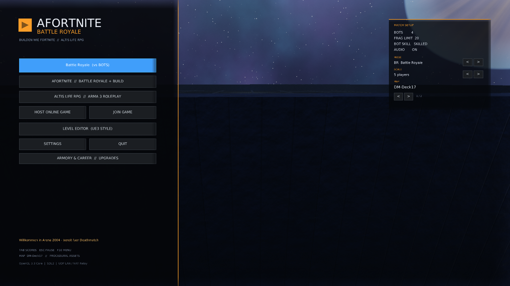
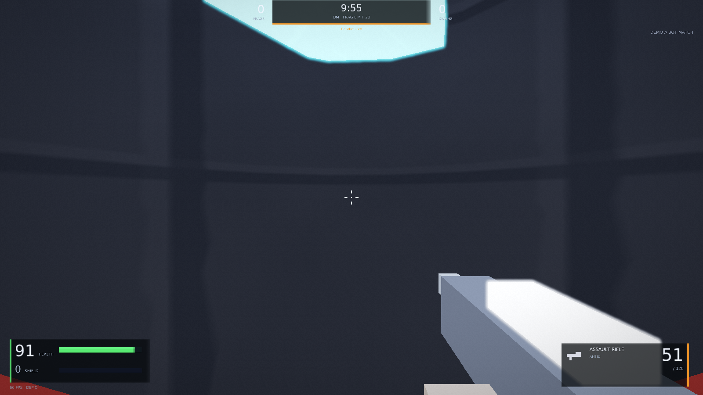
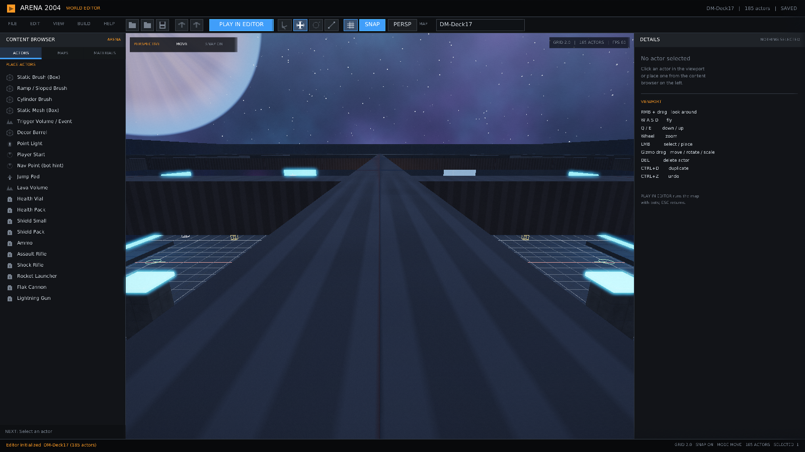
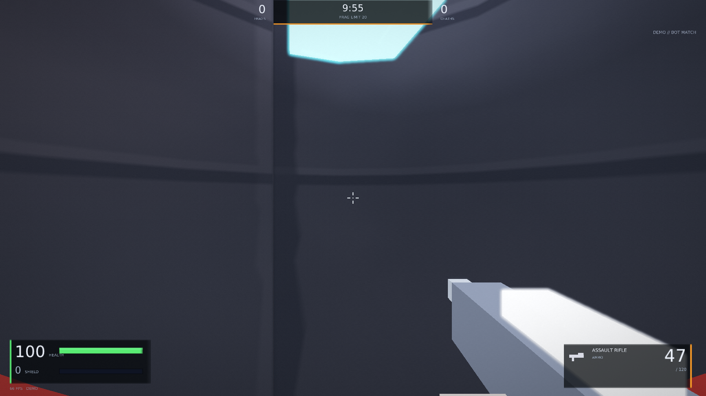

# Arena2004

Ein schneller Arena-Shooter im Stil von **Unreal Tournament 2004** – komplett neu
implementiert mit **C11, SDL2 und OpenGL 3.3 Core**. Kein Unreal-Engine-Code, keine
externen Spiel-Assets: Map, Texturen, Meshes, Sounds und Musik werden prozedural erzeugt.

Enthalten sind:

* **9 Spielmodi**: Deathmatch, Team Deathmatch, CTF, Vehicle-CTF, Assault,
  Onslaught, Conquest (Battlefield-Stil), RPG und Battle Royale
* **Match-Größen von 5v5 bis 30.000 Spieler** – große Populationen laufen als
  PlanetSide-artige Zonen mit Metin2-artigen Channels
* **Fahrzeuge, Flaggen, Control Nodes und zerstörbare Ziele**
* **5 UT-typische Waffen** mit Primär- und Sekundärfeuer
* **Bewegung wie in UT**: Dodge, Double Jump, Sprungfelder, Air Control
* **Zwei Arenen**: `DM-Deck17` (Lava, Catwalks, Rampen, Jump Pads) und
  `DM-Rankin` (kompakte Symmetrie-Arena mit zentraler Plattform)
* **UE3-artiger Level-Editor** mit Content-Browser, Details-Panel, Gizmos,
  Grid/Snap, Undo/Redo, Map-Speichern und **Play-in-Editor (PIE)**
* **Bots mit hybrider Navigation**: automatischer Nav-Graph aus der Map plus
  optionale Unreal-artige `NavPoint`-Hinweise; A*, String-Pulling, Jump-Pads
* **Online-Spiel**: direkte LAN-Verbindung per IP oder NAT-freundlich über
  Lobby-Server mit 4-stelligem Raumcode, inkl. Passwortschutz
* **Gothic-/Quake-Konsole** mit Autovervollständigung, History, Scrollback und
  OpenCode-Start direkt aus dem Spiel
* HUD, Scoreboard, Killfeed, Announcer, Netgraph, 60+-FPS-Gameplay
* Prozedurale Grafik mit Bloom, ACES-Tonemapping, Vignette, Filmkorn, Nebel,
  Weltraum-Skybox und Partikeleffekten
* **Linux, Windows und macOS** aus einer Codebasis (SDL2 + CMake/GitHub Actions)






---

## Bauen

Voraussetzungen (Debian/Ubuntu):

```bash
sudo apt install build-essential pkg-config libsdl2-dev libglew-dev \
                 libgl1-mesa-dev libpng-dev
```

Dann im Projektordner:

```bash
make -j$(nproc)
```

Erzeugt:

* `arena2004` – Spiel und Editor
* `arena2004_lobby` – Lobby-/NAT-Relay-Server

Alternativ baut `./run.sh` beim ersten Start automatisch.

### CMake (Linux, macOS, Windows)

```bash
cmake -S . -B build -DCMAKE_BUILD_TYPE=Release
cmake --build build -j$(nproc)
```

* **macOS**: `brew install cmake sdl2 glew libpng pkg-config`, danach derselbe
  CMake-Aufruf. OpenGL wird als Framework gelinkt.
* **Windows**: MSYS2 MinGW64 mit `mingw-w64-x86_64-{toolchain,cmake,ninja,SDL2,glew,libpng}`.
  Die benötigten DLLs (`SDL2.dll`, `glew32.dll`, `libpng16-16.dll`, `zlib1.dll`)
  müssen neben der EXE liegen; `scripts/package.sh` sammelt sie ein.
* **Steamworks** ist optional. Ohne SDK startet das Spiel als DRM-freier Build;
  liegt `steam_api` neben der EXE, wird sie zur Laufzeit geladen
  (`src/steam_bridge.c`).

### Pakete und Releases

```bash
scripts/package.sh          # dist/<os>/ + dist/arena2004-<os>.zip
cpack -G ZIP                # im build/-Ordner (CMake)
```

Die GitHub-Actions-Workflow-Datei `.github/workflows/build.yml` baut bei jedem
Push Linux-, macOS- und Windows-Artefakte. Ein Tag startet zusätzlich einen
Release-Job, der die drei ZIPs automatisch an das GitHub-Release anhängt:

```bash
git tag v0.9.1
git push origin v0.9.1
```

Dieselben Pakete dienen als Steam-Depot-Inhalt (`steam/README.md`).

### Starten

```bash
./arena2004                 # Menü
./arena2004 --demo          # direkt ein Bot-Match
./arena2004 --editor        # direkt in den Editor
./arena2004 --fullscreen    # Vollbild
```

Getestet mit SDL2 2.32, GLEW 2.3, OpenGL 3.3/4.6 auf Linux/X11.

---

## Steuerung im Spiel

| Taste | Funktion |
|---|---|
| `W A S D` | Laufen |
| Maus | Umsehen |
| Linke Maustaste | Primärfeuer |
| Rechte Maustaste | Sekundärfeuer |
| Leertaste | Springen / Double Jump |
| `Shift` | Dodge (Richtung + Shift) |
| `Strg` | Ducken |
| `1`–`5` / Mausrad | Waffe wechseln |
| `Tab` | Scoreboard |
| `Esc` | Pause |
| `F5` | Match neu starten |
| `F10` | Zurück zum Menü |
| `F11` | Vollbild an/aus |

### Menü & Map-Auswahl

Im Hauptmenü zeigt die rechte Karte die aktuell geladene Arena. Mit den
Pfeilen `<` / `>` lässt sich durch alle Maps in `maps/*.map` wechseln; die
Auswahl wird sofort geladen und gilt für Demo-Match, Online-Spiel und Editor.

### Waffen

| Slot | Waffe | Primär | Sekundär |
|---|---|---|---|
| 1 | Assault Rifle | schnelles Feuer | schwerer Einzelschuss |
| 2 | Shock Rifle | Hitscan-Schuss | Shock-Ball (mit Primärfeuer zur Combo zünden) |
| 3 | Rocket Launcher | Rakete | abprallende Granate |
| 4 | Flak Cannon | Streuschuss | Flak-Granate |
| 5 | Lightning Gun | Hitscan | geladener Schuss (mehr Schaden) |

---

## Spielmodi

| Kürzel | Modus | Ziel |
|---|---|---|
| `DM` | Deathmatch | Frag-Limit erreichen |
| `TDM` | Team Deathmatch | Team-Frags bis zum Limit |
| `CTF` | Capture the Flag | gegnerische Flagge 5× nach Hause bringen |
| `VCTF` | Vehicle CTF | CTF mit Scorpion, Manta und Goliath |
| `ASSAULT` | Assault | zwei Objectives angreifen/verteidigen |
| `ONSLAUGHT` | Onslaught | 3 Control Nodes halten, dann den Power Core zerstören |
| `CONQUEST` | Conquest (Battlefield) | 5 Capture Points halten, Tickets abbauen |
| `RPG` | RPG | Level/XP, höhere HP und Schaden pro Level |
| `BR` | Battle Royale | Fortnite/H1Z1-artige shrinking Zone, letzter Überlebender gewinnt |

Modus im Menü über **MODE `<` / `>`** wählen oder per Konsole/CLI:

```bash
./arena2004 --demo --mode ctf
./arena2004 --host --mode conquest --scale 64v64
```

Konsole: `mode ctf`, `objectives`, `score`, `vehicle red`, `team red`.

### Fahrzeuge

In `VCTF` und auf Wunsch per `vehicle [team]` stehen drei Fahrzeugtypen bereit:
**Scorpion** (schnell, leicht), **Manta** (wendig, Flug) und **Goliath** (schwer,
viel HP). Mit `E` steigt man in der Nähe ein und wieder aus; Fahrzeuge schießen
mit Primärfeuer und haben eigene HP.

---

## Bot-Navigation: automatisch + optionale Unreal-Punkte

Die Bots nutzen eine **Hybrid-Navigation**. Empfehlung: automatische Berechnung
als Basis, `NavPoint`-Actor nur als Korrektur für Stellen, die die Geometrie-
Analyse nicht sauber erkennt.

**Automatisch (Counter-Strike-artig):**

* Der Nav-Graph wird beim Matchstart aus der Map-Geometrie gebaut: Spalten-
  Raycasts finden Böden, Catwalks und mehrere Etagen.
* Adaptive Grid-Größe und dynamische Map-Grenzen funktionieren auch für
  Editor-Maps ohne manuelle Pfadpunkte.
* A* mit String-Pulling verhindert Zickzack-Laufen; Lava, Wände und Abstürze
  werden geprüft.
* Jump-Pads erhalten gerichtete Links entlang ihrer Flugbahn.
* Die größte zusammenhängende Insel bleibt erhalten, damit Bots nicht auf
  Dächern oder Zierflächen stranden.

**Optional (Unreal-artig):**

* `ACT_NAV_POINT` im Editor platzieren oder per Konsole `spawn navpoint`.
* Der Punkt rastet auf den Boden darunter ein und überbrückt engere Stellen
  mit größerem Link-Radius.
* Hinweis-Inseln werden beim Pruning geschützt.

Konsole:

```text
nav                 # Knoten, Links, vertikale Links, isolierte Knoten, Hinweise
nav rebuild         # nach Map-Änderungen neu berechnen
spawn navpoint      # UT-artigen Pfadhinweis setzen
```

`NAV` zeigt zusätzlich `Hinweis-Punkte`. Im Selftest muss der Graph erreichbar
sein, und platzierte NavPoints müssen als Knoten überleben.

---

## Große Schlachten: Scales, Zonen und Channels

Die Match-Größe lässt sich im Menü (**SCALE**) oder per Konsole/CLI setzen:

```bash
./arena2004 --demo --scale 5v5       # kleines Duell
./arena2004 --demo --scale 32v32
./arena2004 --demo --scale 128v128
./arena2004 --demo --scale 1000      # 1000 Spieler
./arena2004 --demo --scale 10000     # Mega-Zone
./arena2004 --demo --scale 30000     # Welt-Server
```

* Bis **1000 Spieler** werden lokal vollständig simuliert (`MAX_PLAYERS`).
* Darüber hinaus teilt der Server die Population in bis zu **12 Zonen**
  (PlanetSide-Stil) und pro Zone in bis zu **64 Channels** (Metin2-Stil).
  Nur die aktive Zone/der aktive Channel wird lokal simuliert; die übrigen
  Populationen werden statistisch geführt.
* Konsole: `scale 64v64`, `mega 10000`, `zones`, `zone 3`, `channels`,
  `channel 1`. Das HUD zeigt aktive Zone, Channel und Gesamtpopulation.
* **Listen-Server: bis zu 32 Spieler** (Host + 31 Bots/Clients, UT2004-Niveau).
  Snapshots werden automatisch in mehrere UDP-Chunks aufgeteilt, damit jedes
  Paket unter 1200 Byte bleibt.
* Die Mega-Zonen (bis 30.000) dienen als Server-/Community-Simulation und für
  große Bot-Matches; 1.000 Spieler werden lokal vollständig simuliert.

---


Der Editor öffnet sich über **LEVEL EDITOR** im Hauptmenü oder mit `--editor`.

* **Linke Leiste**: Content-Browser mit `ACTORS`, `MAPS`, `MATERIALS`
* **Rechts**: Details-Panel für Position, Größe, Rotation, Material, Farbe,
  Licht, Flags und Pickup-Typ
* **Viewport**: rechtes Maustaste = Umsehen, `WASD` = Fliegen, `Q/E` = runter/hoch,
  `Shift` = schneller
* **Gizmos**: Move/Rotate/Scale über die Toolbar; Achsen im Viewport ziehen
* **Platzieren**: Actor im Content-Browser wählen, dann in den Viewport klicken
* **Snap/Grid**: ein-/ausschaltbar, Rastergröße im Details-Panel
* **Undo/Redo**: `Strg+Z` / `Strg+Y`
* **Duplizieren**: `Strg+D`, **Löschen**: `Entf`
* **PIE**: `PLAY IN EDITOR` oder `F5` – testet die Map sofort im Spiel
* **Speichern**: Map-Name eintragen und Speichern-Icon klicken (`maps/*.map`)

Der Editor schreibt ein einfaches, lesbares Textformat. Mitgeliefert sind
`maps/DM-Deck17.map` und `maps/DM-Rankin.map`; eigene Maps erscheinen nach dem
Speichern automatisch in der Map-Auswahl des Hauptmenüs.

---

## Online spielen

### Variante A – LAN / direkte IP

Auf Rechner 1 (Host):

```bash
./arena2004 --host --port 7777 --room "LAN Arena"
```

Im Menü alternativ **HOST ONLINE GAME** wählen. Auf Rechner 2:

```bash
./arena2004 --join 192.168.1.20 --port 7777
```

Der Port `7777/udp` muss im LAN erreichbar sein.

### Variante B – Internet über Lobby / NAT-Relay

Der Relay-Server vermittelt alle Pakete, daher muss **weder Host noch Client**
einen Port weiterleiten.

1. Lobby-Server starten (irgendwo öffentlich erreichbar):

   ```bash
   ./arena2004_lobby 7777
   ```

2. Host startet mit Lobby:

   ```bash
   ./arena2004 --host --port 7777 \
       --lobby 203.0.113.10:7777 --room "Public Arena"
   ```

3. Der Host sieht im Menü/Log einen **4-stelligen Raumcode**, z. B. `C1AD`.

4. Client tritt bei:

   ```bash
   ./arena2004 --join 127.0.0.1 --port 7777 \
       --lobby 203.0.113.10:7777 --code C1AD
   ```

Im Menü gibt es dafür **JOIN GAME → USE LOBBY CODE**.

Der Lobby-Server unterstützt bis zu 64 Räume und 32 Spieler pro Raum. Er ist
absichtlich dependency-frei und kann auch als systemd-Dienst laufen.

### Passwortschutz

```bash
./arena2004 --host --password geheim
./arena2004 --join 192.168.1.20 --joinpassword geheim
```

Falsche Passwörter werden serverseitig abgelehnt und im Host-Log protokolliert.
Der Host kann das Passwort auch in der Konsole mit `password <pw>` setzen.

---

## Konsole

Die Konsole öffnet sich im Spiel mit `^` (Zirkumflex) oder `~` und arbeitet wie
in Gothic/Quake/RTCW:

* Autovervollständigung mit `Tab`, History mit `↑`/`↓`, Scrollback mit `Bild↑`/`Bild↓`
* Befehle und Variablen: `help`, `status`, `mode`, `scale`, `mega`, `zones`,
  `channels`, `objectives`, `score`, `vehicle`, `addbot`, `removebot`, `map`,
  `save`, `load`, `trigger`, `password`, `netgraph`, `set <var> <wert>`
* **OpenCode starten**: `opencode` öffnet OpenCode im Projektordner, optional
  mit Aufgabe (`opencode fix the bot pathing`). Damit lässt sich das Spiel
  direkt aus der Konsole heraus erweitern.
* Alle wichtigen Aktionen sind auch ohne Maus erreichbar; im Menü und Editor
  steuert ein virtueller Cursor per Pfeiltasten.

---

## CLI-Optionen

```
--demo                 Bot-Demo-Match starten
--editor               Editor starten
--map FILE             Map laden
--host                 Online-Spiel hosten
--join IP              Spiel über IP betreten
--port N               UDP-Port (Standard 7777)
--lobby HOST[:PORT]    Lobby/NAT-Relay verwenden
--code CODE            Raumcode zum Beitreten
--room NAME            Raumname beim Hosten
--mode NAME            dm|tdm|ctf|vctf|assault|onslaught|conquest|rpg|br
--scale N|5v5|32v32    Matchgröße (bis 30000 Spieler/Zonen)
--password PW          Host-Passwort / Zugangskontrolle
--joinpassword PW      Passwort beim Beitreten
--bots N               Anzahl Bots (bis 999; große Werte = Scale, Listen-Server max. 31)
--seconds N            nach N Sekunden automatisch beenden
--netlog               Netzwerkstatus jede Sekunde ausgeben
--stats                Match-Statistik beim Beenden ausgeben
--capture FILE         Screenshot nach --frames speichern
--frames N             Framezahl für Capture
--benchmark N          N Frames rendern und FPS ausgeben
--bottest N            N Sekunden Bot-Simulation mit Bewegungs-/Pfad-Checks
--selftest             automatischer Engine-/Game-/Editor-Test
--width N --height N   Fenstergröße
--hidden               unsichtbares Fenster (für Tests)
--fullscreen           Vollbild
```

Beispiele:

```bash
./arena2004 --hidden --demo --seconds 30 --stats
./arena2004 --hidden --demo --mode br --scale 128 --seconds 60 --stats
./arena2004 --hidden --demo --mode conquest --scale 30000 --stats
./arena2004 --hidden --benchmark 600
./arena2004 --hidden --capture shots/arena.png --frames 120 --demo
tests/net_test.sh
```

---

## Projektstruktur

```
src/math3d.h      Vektoren, Matrizen, Rays, AABBs, Kamera
src/gl_util.*     Shader, Meshes, FBOs, prozedurale Texturen, PNG-Export
src/ui.*          Immediate-Mode-UI, Font-Atlas, Widgets, Theme
src/world.*       Actor-/Map-Modell, Kollision, Raycast, DM-Deck17, Speichern/Laden
src/render.*      Szenen-Renderer, Skybox, Licht, Bloom, FX, Debug-Lines
src/game.*        Spielmodi, Teams, Objectives, Fahrzeuge, BR/RPG, Zonen/Channels
src/hud.*         HUD, Crosshair, Killfeed, Scoreboard, Netgraph, Overlays
src/audio.*       prozedurale SFX und Musikschleifen (SDL2_mixer)
src/editor.*      UE3-artiger Editor inkl. PIE
src/net.*         UDP-Client/Host, Snapshots, Passwort-Handshake, Relay-Anbindung
src/netproto.h    Wire-Protokoll (NET_VERSION, PKT_MAX_PLAYERS = 8)
src/lobby.c       eigenständiger Lobby-/NAT-Relay-Server
src/platform.h    portabler Socket-/Sleep-/Dateisystem-Layer
src/steam_bridge.* optionaler Steamworks-Loader (DLOPEN/LoadLibrary)
src/main.c        Fenster, Moduswechsel, Menü, Konsole, CLI
CMakeLists.txt    Linux/macOS/Windows-Build + CPack
scripts/          package.sh (Release-ZIPs), steam_upload.sh
steam/            App-/Depot-VDF-Vorlagen, Achievements, Anleitung
assets/fonts/     DejaVu-Fonts für die UI
maps/             Text-Maps (DM-Deck17, DM-Rankin)
tests/net_test.sh End-to-End-Netzwerktest
tests/listen_test.sh 32-Spieler-Listen-Server + gechunkte Snapshots
tests/bot_test.sh  Bot-/Simulationsmatrix inkl. 1k-BR
```

---

## Technische Hinweise

* OpenGL **3.3 Core Profile**, GLSL 330, GLEW, SDL2
* Renderpfad: HDR-Framebuffer → Bright-Pass → separabler Blur → ACES-Composite
* Kollision: AABB-/Brush-/Rampen-/Zylinder-Volumen mit Sweep-Auflösung
* Bots: hybride Navigation aus automatischem Nav-Graph plus optionalen
  `ACT_NAV_POINT`-Hinweisen; A* mit String-Pulling, Jump-Pad-Links, Multi-Floor-
  Scan, Kantenschutz und Island-Pruning. Dazu Zielwahl, Aim-Fehler,
  Strafe-/Dodge-Verhalten und Waffenpräferenzen. `--bottest N` simuliert
  kopflos und prüft Bewegung, Pfade und steckengebliebene Bots.
* Große Matches: lokale Simulation bis 1000 Spieler; darüber statistische
  Zonen/Channels mit LOD-KI. Nur die aktive Zone wird vollständig simuliert.
* Battle Royale: Fortnite/H1Z1-artige Zone mit 6 Schrumpfstufen und
  Schadens-Ticks außerhalb des Kreises; Bots fliehen aktiv ins Zentrum
* RPG: XP/Level pro Session, höhere Max-HP und Schadensmultiplikatoren
* Netzwerk: eigenes UDP-Protokoll (`src/netproto.h`) mit Sequenznummern,
  Snapshots (20 Hz), Client-Inputs (30 Hz), Ping/Pong, Passwort-Handshake und
  Timeouts. Bis zu 32 Spieler pro Listen-Server; Snapshots werden gechunkt.
  Beitretende Menschen übernehmen bei vollem Server einen Bot-Slot.
* Alle Sounds und Musik werden zur Laufzeit synthetisiert
* Screenshots werden per `glReadPixels` und libpng geschrieben
* Steam ist optional: `src/steam_bridge.c` lädt `steam_api` dynamisch; ohne
  Bibliothek läuft das Spiel vollständig DRM-frei.

## Teststatus

```bash
make -j$(nproc)
./arena2004 --selftest                 # PASS (inkl. aller 9 Modi, 256/30000-Scale)
./arena2004 --bottest 12               # PASS (Bots bewegen sich, A* findet Pfade)
tests/net_test.sh                      # PASS (Lobby, Raumcode, Passwort, Modus)
tests/listen_test.sh                   # PASS (21 Spieler, gechunkte Snapshots)
tests/bot_test.sh                      # PASS (alle Modi, 1k-BR, 30k-Zone)
./arena2004 --hidden --demo --seconds 60 --stats
./arena2004 --hidden --demo --mode br --scale 500 --seconds 60 --stats
./arena2004 --map maps/DM-Rankin.map --hidden --demo --seconds 30 --stats
./arena2004 --hidden --benchmark 600
```

Der Selftest prüft Menü-, Spiel-, Editor- und PIE-Rendering (inkl. PNG-Export),
Map-Speichern/-Laden, Netzwerk-Socket, Audio sowie alle Spielmodi und die
Zonen-/Channel-Konfiguration bis 30.000 Spieler. Der Netzwerktest startet den
Lobby-Server, registriert einen Host mit Raumcode, testet falsche und richtige
Passwörter und verbindet einen Client über den Relay. `listen_test.sh` prüft
den 32-Spieler-Listen-Server mit gechunkten Snapshots. `bot_test.sh` simuliert
alle Modi, 128v128, 1.000er-BR und die 30.000er-Zone. Der Selftest prüft
zusätzlich die lokale Spielerbewegung (WASD/Achsen) und die Bot-Navigation.
Zusätzlich wurde der Selftest unter AddressSanitizer/UBSan ausgeführt.

## GitHub und Steam

Das Projekt ist so vorbereitet, dass derselbe Quellcode auf GitHub und Steam
veröffentlicht werden kann:

* **GitHub**: Repository anlegen, `git push`, Tag `v0.9.1` setzen – der Workflow
  baut Linux/macOS/Windows-ZIPs als Artefakte.
* **Steam**: AppID/DepotIDs in `steam/*.vdf` eintragen, `scripts/package.sh`
  ausführen, dann `STEAM_USER=... scripts/steam_upload.sh`. Details stehen in
  `steam/README.md`. Die Store-Seite, Builds und Freigabe erfolgen im
  Steamworks-Partnerportal.

## Bekannte Grenzen

Das Projekt ist eine eigenständige Hommage, kein Unreal-Engine-Port. Es gibt
keinen BSP-/CSG-Brush-Editor, kein UnrealScript und keine Original-UT-Assets.
Die Netzwerk-Synchronisation ist bewusst einfach (Host-autoritative Snapshots
mit lokaler Prädiktion) und auf 32 Spieler pro Listen-Server ausgelegt.
1.000 Spieler laufen lokal vollständig; Populationen darüber sind statistische
Zonen/Channels, keine echte 1:1-Simulation jedes Spielers. Für echte
1000er-Netzwerkrunden wäre Server-Meshing/Sharding der nächste Schritt. Steamworks-Features (Achievements, Cloud, Lobby) sind vorbereitet,
aber ohne SDK nicht aktiv.

Viel Spaß in der Arena!
